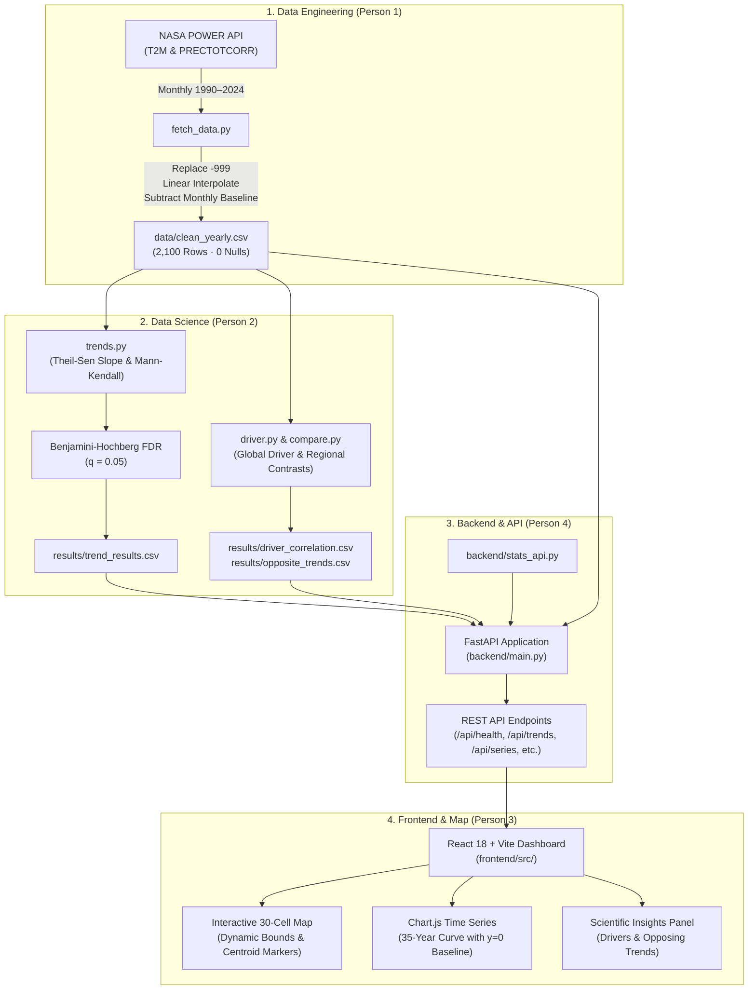

# TerraPulse

**NASA Space Apps Challenge 2026** — *Discovering the Pulse of a Changing Planet.*
*(Challenge Prompt: Be An Earth System Trend Detective!)*
**Team:** Crescent Coder Girls

[](https://fastapi.tiangolo.com)
[](https://react.dev)
[](https://vitejs.dev)
[](https://python.org)
[](https://leafletjs.com)
[](https://tailwindcss.com)

---

## 1. Project Overview

**TerraPulse** is an interactive, full-stack scientific web platform designed to uncover, validate, and visualize multi-decadal environmental and climate trends from 1990 to 2024.

By analyzing 35 continuous years of NASA Earth science observations across a standardized 30-cell global grid ($5 \text{ latitudes} \times 6 \text{ longitudes}$), our application separates long-term climate signals from natural seasonal variability. It features non-parametric statistical modeling, False Discovery Rate (FDR) multiple testing correction, a high-performance FastAPI backend, and an interactive React/Leaflet dashboard.

---

## 2. Problem Statement

Earth's climate system exhibits pronounced natural variability—such as seasonal cycles, El Niño Southern Oscillation (ENSO), and regional oscillations—that frequently mask multi-decadal trends. Ordinary citizens, students, and decision-makers often face two major challenges:
1. **Raw data complexity:** Satellite and reanalysis datasets contain missing values, seasonal biases, and multiple testing anomalies.
2. **Oversimplified narratives:** Global warming does not occur uniformly; certain areas experience rapid warming or drying while others experience contrasting regional responses.

**TerraPulse** addresses these challenges by applying rigorous, non-parametric statistics to NASA observations and presenting clear, interactive visual evidence.

---

## 3. Project Objectives

- **Empirical Rigor:** Process 35 continuous years (1990–2024) of NASA data without subjective thresholds or artificial smoothing.
- **Robust Statistical Modeling:** Calculate annual rates of change using the robust Theil-Sen slope estimator and evaluate monotonic trends via the Mann-Kendall rank test.
- **False Positive Control:** Apply Benjamini-Hochberg False Discovery Rate (FDR) adjustments across all 30 global locations.
- **Full-Stack Accessibility:** Expose all data via clean RESTful API endpoints alongside an interactive client-side dashboard with automatic offline CSV fallback.

---

## 4. NASA Data Sources Used

All historical data was sourced directly from the **NASA Langley Research Center POWER Project** (Prediction Of Worldwide Energy Resources):
- **API Endpoint:** `https://power.larc.nasa.gov/api/temporal/monthly/point`
- **User Community:** `AG` (Agroclimatology)
- **Temporal Period:** Monthly observations from January 1990 to December 2024 (420 months per coordinate).
- **Physical Parameters:**
  - `T2M`: Temperature at 2 Meters (°C) $\rightarrow$ Labeled as **Temperature**.
  - `PRECTOTCORR`: Precipitation Corrected (mm/day) $\rightarrow$ Labeled as **Rainfall**.
- **Spatial Coverage:** 30 global sampling coordinates:
  - Latitudes (5): $-60^\circ, -30^\circ, 0^\circ, 30^\circ, 60^\circ$
  - Longitudes (6): $-150^\circ, -90^\circ, -30^\circ, 30^\circ, 90^\circ, 150^\circ$

---

## 5. System Architecture



---

## 6. Scientific & Statistical Methodology

### 1. Data Cleaning & Anomaly Computation
- **Missing Value Handling:** NASA missing flags (`-999`) were replaced with `NaN` and linearly interpolated in time (maximum limit of 3 consecutive months).
- **Seasonal Baseline Subtraction:** To eliminate periodic summer/winter cycles, each month's 35-year climatological average was subtracted:
  $$\text{Anomaly}(m, y) = \text{Value}(m, y) - \overline{\text{Value}}(m)_{1990-2024}$$
- **Annual Aggregation:** Monthly anomalies were averaged across each year into `clean_yearly.csv` ($30 \text{ points} \times 35 \text{ years} \times 2 \text{ variables} = 2,100 \text{ rows}$).

### 2. Trend Slope & Significance
- **Theil-Sen Robust Estimator (`theilslopes`):** Determines the median annual rate of change ($\text{slope}$) and 95% confidence intervals, resistant to extreme outliers.
- **Mann-Kendall Rank Correlation (`kendalltau`):** Evaluates monotonic trend direction and calculates exact non-parametric $p$-values.
- **Total Change (35 Years):** Computed as $\Delta = \text{slope} \times 34$.
- **Benjamini-Hochberg FDR Correction:** Corrects $p$-values for family-wise error across multiple spatial comparisons ($p_{\text{fdr}} < 0.05$).

### 3. Classification Rules (`trend_map`)
- **Red (Code: 1):** Statistically significant increase ($\text{slope} > 0$ and $p_{\text{fdr}} < 0.05$).
- **Blue (Code: -1):** Statistically significant decrease ($\text{slope} < 0$ and $p_{\text{fdr}} < 0.05$).
- **Grey (Code: 0):** No statistically significant trend detected ($p_{\text{fdr}} \ge 0.05$).
- **Amber Outline:** Missing or invalid data (never defaulted to grey).

---

## 7. Technology Stack

| Layer | Technologies |
|---|---|
| **Data Engineering** | Python 3.13, Requests, Pandas, NumPy |
| **Statistical Analysis** | SciPy (`theilslopes`, `kendalltau`, `pearsonr`), NumPy, Pandas |
| **Backend & REST API** | FastAPI 0.110+, Uvicorn 0.28+, Pydantic v2, Starlette |
| **Frontend Framework** | React 18.3, Vite 6.0, JavaScript (ESM) |
| **Mapping & Geospatial** | Leaflet 1.9.4, CartoDB Dark Matter Tiles, Haversine formula |
| **Visualization** | Chart.js 4.4, `react-chartjs-2`, Tailwind CSS 3.4, Lucide Icons |
| **Data Parsing** | PapaParse 5.4 |

---

## 8. Backend REST API Endpoints

The FastAPI server provides high-speed, CORS-enabled endpoints:

- **`GET /api/health`**
  Returns service status and confirms all four CSV datasets are loaded in memory.
- **`GET /api/variables`**
  Returns available climate variables, descriptions, and NASA parameter codes (`T2M`, `PRECTOTCORR`).
- **`GET /api/trends?variable={Temperature|Rainfall}`**
  Returns trend slopes, confidence intervals, $p$-values, FDR adjusted significance, and `trend_map` codes for all 30 cells.
- **`GET /api/series?variable={var}&lat={lat}&lon={lon}`**
  Returns the complete 35-year annual anomaly array (1990–2024) for the nearest grid point.
- **`GET /api/stats?variable={var}&lat={lat}&lon={lon}`**
  Queries Person 2's nearest spatial cell statistics and formatted labels.
- **`GET /api/drivers`**
  Returns Pearson correlation results against latitude-weighted global mean temperature.
- **`GET /api/comparisons`**
  Returns empirical evidence of regional climate divergence (opposing trends).

Interactive Swagger API documentation is available at: **`http://localhost:8000/docs`**

---

## 9. Frontend Dashboard Features

1. **Interactive 30-Cell Grid Map:**
   - Visualizes dynamic polygon cells derived from actual coordinate midpoints.
   - Distinct centroid markers ensure visibility across extreme polar and equatorial latitudes.
   - **Haversine Snapping:** Clicking anywhere on the globe snaps to the nearest grid cell, correctly normalizing for the antimeridian ($\pm 180^\circ$ longitude wraparound).
2. **Dual-Variable Selector:**
   - Seamlessly toggle between **Temperature** and **Rainfall**.
3. **KPI Cards:**
   - Displays real-time cell metrics: Coordinate, Annual Rate of Change, 35-Year Total Change, and FDR $p$-value.
4. **Historical Time-Series View:**
   - Renders 35 annual observations (1990–2024) with a custom horizontal zero reference baseline ($y=0$).
5. **Scientific Insights Panel:**
   - Live display of global temperature drivers and regional divergence evidence.
6. **Dual-Mode Data Architecture:**
   - Automatically connects to the live FastAPI backend with sub-second queries.
   - Seamlessly falls back to local static CSV parsing via PapaParse if the backend is offline.

---

## 10. Installation & Setup Guide

### Prerequisites
- **Python:** Version 3.10 to 3.13
- **Node.js:** Version 18.0 or higher (with `npm`)

---

### Step 1: Clone the Repository
```bash
git clone https://github.com/umamakhan9/Crescent-Coder-Girls-.git
cd Crescent-Coder-Girls-
```

---

### Step 2: Start the Backend (FastAPI)

1. Open a terminal and navigate to the backend directory:
   ```bash
   cd backend
   ```
2. Install Python dependencies:
   ```bash
   pip install -r requirements.txt
   ```
3. Start the Uvicorn server:
   ```bash
   uvicorn main:app --reload --port 8000
   ```
4. Confirm backend health: Open [http://localhost:8000/api/health](http://localhost:8000/api/health) in your browser.

---

### Step 3: Start the Frontend (React + Vite)

1. Open a new terminal and navigate to the frontend directory:
   ```bash
   cd frontend
   ```
2. Install dependencies:
   ```bash
   npm install
   ```
3. Start the Vite development server:
   ```bash
   npm run dev
   ```
4. Open the application: Navigate to [http://localhost:5173/](http://localhost:5173/).

---

### Production Cloud Deployment (Render + Vercel)

TerraPulse is production-ready for automated cloud hosting:
- **FastAPI Backend on Render:** Ready for 1-click deploy via [`render.yaml`](render.yaml) (`uvicorn main:app --host 0.0.0.0 --port $PORT`, root dir `backend`).
- **React/Vite Frontend on Vercel:** Ready for Vite preset deploy with `frontend/vercel.json` SPA rewrites and bundled static CSV fallback.
- **Detailed Step-by-Step Guide:** See [`docs/deployment.md`](docs/deployment.md) for full instructions, environment variable setup (`VITE_API_URL`), and post-launch verification.

---

## 11. Team Contributions

| Team Member | Role | Key Contributions |
|---|---|---|
| **Person 1** | **Data Engineer** | NASA POWER API data acquisition (`fetch_data.py`), missing value imputation (`-999` $\rightarrow$ NaN interpolation), monthly anomaly calculation, and annual dataset aggregation (`clean_yearly.csv`). |
| **Person 2** | **Data Scientist** | Statistical methodology (`trends.py`, `driver.py`, `compare.py`), non-parametric Theil-Sen slope estimation, Mann-Kendall rank tests, Benjamini-Hochberg FDR correction, and spatial helper script (`stats_api.py`). |
| **Person 3** | **Frontend & Map Developer** | React/Vite dashboard design, Leaflet custom polygons, CartoDB tile integration, Chart.js time-series with zero baseline, Haversine antimeridian snapping, and Tailwind UI. |
| **Person 4** | **Backend & Pitch Lead** | Full-stack architecture, FastAPI REST service (`main.py`), automated test suite (`test_backend.py`), zero-failure CSV fallback integration, project documentation, and 3-minute hackathon pitch. |

---

## 12. Limitations & Future Work

### Current Limitations
- **Spatial Resolution:** Global coverage is currently sampled across a regular 30-cell grid ($30^\circ \times 60^\circ$ steps) to guarantee fast browser interaction and low bandwidth overhead.
- **Temporal Granularity:** Analysis uses annual anomaly means; extreme daily weather events (e.g., heat waves, flash floods) are not captured in the yearly aggregated index.

### Future Improvements
- **Higher Resolution Grid:** Ingest gridded $1^\circ \times 1^\circ$ NASA MERRA-2 and CERES reanalysis data using cloud-native Zarr format.
- **Machine Learning Projections:** Train autoregressive LSTM models to project 5-year trend envelopes with uncertainty bounds.
- **Additional Variables:** Integrate NASA Soil Moisture (SMAP) and Vegetation Index (MODIS NDVI) to correlate drought impacts with temperature trends.

---

## 13. License

Developed for the **NASA Space Apps Challenge 2026**. Historical NASA data is distributed under NASA Open Data Policy.
