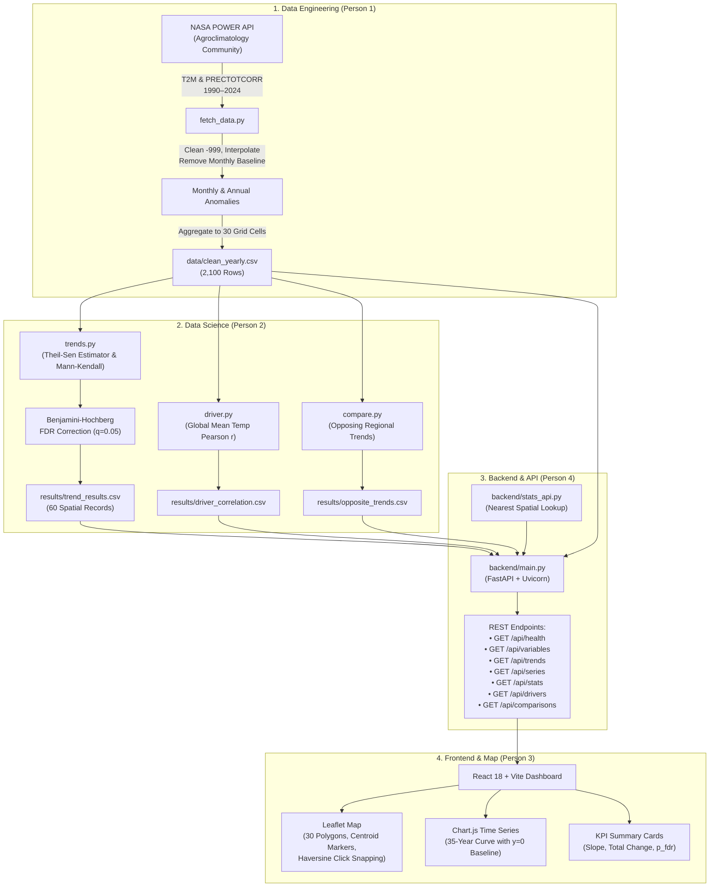

# Earth Trend Detective — System Architecture

## NASA Space Apps Challenge 2026

**Project Title:** Earth Trend Detective
**Team:** Crescent Coder Girls

---

## 1. High-Level Architectural Diagram

---

## 2. Component Details

### A. Data Engineering
- **Source:** NASA Langley Research Center POWER API (`https://power.larc.nasa.gov/api/temporal/monthly/point`).
- **Variables:**
  - `T2M` (Air Temperature at 2 Meters, °C) $\rightarrow$ labeled **Temperature**.
  - `PRECTOTCORR` (Precipitation Corrected, mm/day) $\rightarrow$ labeled **Rainfall**.
- **Spatial Coverage:** 30 global sample locations ($5 \text{ latitudes} \times 6 \text{ longitudes}$):
  - Latitudes: $-60^\circ, -30^\circ, 0^\circ, 30^\circ, 60^\circ$
  - Longitudes: $-150^\circ, -90^\circ, -30^\circ, 30^\circ, 90^\circ, 150^\circ$
- **Temporal Period:** 1990 to 2024 (35 continuous calendar years).
- **Processing:** Missing values (`-999`) interpolated with `limit=3`; 35-year monthly seasonal mean subtracted to compute deviations/anomalies; aggregated into annual values.

### B. Statistical Modeling & Analysis
- **Non-Parametric Trend Detection:** Theil-Sen robust linear slope estimator paired with the Mann-Kendall rank test (`scipy.stats.kendalltau`).
- **Multiple Testing Correction:** Benjamini-Hochberg False Discovery Rate (FDR) adjustment controlling family-wise false positives across the 30 spatial cells per variable.
- **Classification Rules:**
  - `trend_map = 1`: Significant Increase ($p_{\text{fdr}} < 0.05$ and $\text{slope} > 0$) $\rightarrow$ Red.
  - `trend_map = -1`: Significant Decrease ($p_{\text{fdr}} < 0.05$ and $\text{slope} < 0$) $\rightarrow$ Blue.
  - `trend_map = 0`: No Significant Change $\rightarrow$ Grey.

### C. Backend & API Service
- **Framework:** FastAPI running on Uvicorn.
- **In-Memory Caching:** Pre-loads datasets for sub-millisecond response times.
- **CORS Enabled:** Full cross-origin access for local frontend development and production hosting.
- **Key Routes:**
  - `/api/health` — Service status and dataset verification.
  - `/api/variables` — Variable metadata.
  - `/api/trends` — Spatial trend grid.
  - `/api/series` — Annual time-series array for any coordinates.
  - `/api/stats` — Nearest-neighbor statistical lookup.
  - `/api/drivers` — Latitude-weighted global driver correlation.
  - `/api/comparisons` — Opposing trend evidence.

### D. Frontend Interface
- **Framework:** React 18 + Vite 6 + Tailwind CSS.
- **Mapping Engine:** Leaflet with CartoDB Dark Matter tiles.
- **Charts:** Chart.js 4 + react-chartjs-2 with zero baseline custom plugin.
- **Spatial UX:** Haversine formula with antimeridian ($\pm 180^\circ$) longitude wraparound to snap clicks anywhere on Earth to the closest grid point.
