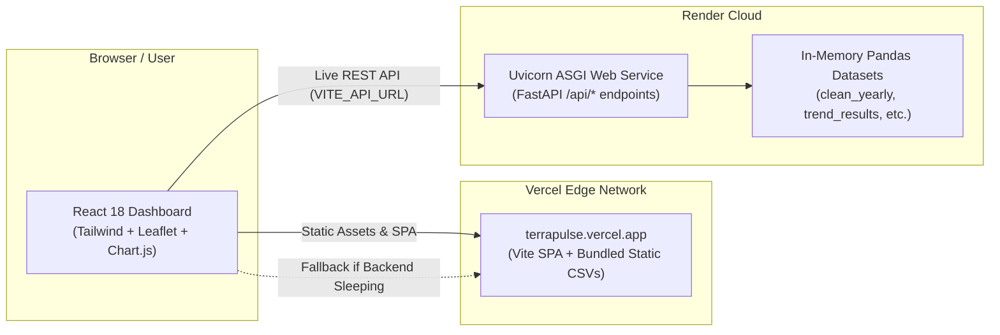

# TerraPulse — Production Cloud Deployment Guide

This guide details how to deploy **TerraPulse** to production cloud platforms:
- **FastAPI Backend:** Deployed on **Render** (Python Web Service)
- **React/Vite Frontend:** Deployed on **Vercel** (Global Edge CDN)

---

## 1. Cloud Architecture Overview



### Key Architectural Strengths
1. **Self-Contained Backend:** The `backend/` directory contains all 4 datasets in `backend/data/` and `backend/results/`, resolving paths independently of host environments.
2. **CORS Fully Configured:** FastAPI enables `allow_origins=["*"]` with RFC-compliant open data access for Vercel preview and production URLs.
3. **Zero-Failure CSV Fallback:** If Render's free tier is waking from sleep (takes ~30s on cold start), the frontend transparently serves static CSVs from `public/data/` with an amber status indicator, switching to green live API data once reachable.
4. **SPA Rewrites:** `frontend/vercel.json` provides clean client-side routing while exempting `/data/*` and `/assets/*` from redirects.

---

## 2. Deploying Backend to Render

### Method A: 1-Click Render Blueprint (Recommended)

1. Log into your [Render Dashboard](https://dashboard.render.com/).
2. Click **New +** $\rightarrow$ **Blueprint**.
3. Connect your GitHub repository: `https://github.com/umamakhan9/Crescent-Coder-Girls-`.
4. Render automatically detects [`render.yaml`](../render.yaml) at the repository root and pre-configures:
   - **Service Name:** `terrapulse-api`
   - **Environment:** `python`
   - **Root Directory:** `backend`
   - **Build Command:** `pip install -r requirements.txt`
   - **Start Command:** `uvicorn main:app --host 0.0.0.0 --port $PORT`
   - **Health Check Path:** `/api/health`
5. Click **Apply**.
6. Render builds the service and assigns a live public URL:
   `https://<service-name>.onrender.com`

---

### Method B: Manual Web Service Setup on Render

If creating the Web Service manually:
1. Go to [Render Dashboard](https://dashboard.render.com/) $\rightarrow$ **New +** $\rightarrow$ **Web Service**.
2. Select **Build and deploy from a Git repository** and pick `Crescent-Coder-Girls-`.
3. Configure the following exact settings:
   - **Name:** `terrapulse-backend` (or your preferred name)
   - **Region:** Any (e.g., *Oregon (US West)* or *Frankfurt (EU)*)
   - **Branch:** `main`
   - **Root Directory:** `backend`
   - **Runtime:** `Python 3`
   - **Build Command:** `pip install -r requirements.txt`
   - **Start Command:** `uvicorn main:app --host 0.0.0.0 --port $PORT`
   - **Instance Type:** `Free`
4. Expand **Advanced**:
   - **Health Check Path:** `/api/health`
   - Add Environment Variable:
     - `PYTHON_VERSION` = `3.11.9`
5. Click **Create Web Service**.
6. Once deployed, copy your service URL (e.g., `https://terrapulse-backend.onrender.com`).

---

## 3. Deploying Frontend to Vercel

1. Log into your [Vercel Dashboard](https://vercel.com/).
2. Click **Add New...** $\rightarrow$ **Project**.
3. Import your GitHub repository `umamakhan9/Crescent-Coder-Girls-`.
4. Configure the project build settings:
   - **Framework Preset:** `Vite`
   - **Root Directory:** Click *Edit* and select `frontend` (Important!)
   - **Build Command:** `npm run build` (auto-detected)
   - **Output Directory:** `dist` (auto-detected)
   - **Install Command:** `npm install` (auto-detected)
5. Expand **Environment Variables**:
   - **Key:** `VITE_API_URL`
   - **Value:** `https://<your-render-backend-url>.onrender.com` (from Step 2, without trailing slash)
6. Click **Deploy**.
7. In ~45 seconds, Vercel will launch your live site at `https://terrapulse.vercel.app` (or your assigned domain).

---

## 4. Post-Deployment Verification & Smoke Tests

### Test 1: Verify Backend Live Endpoints
Run these tests in your browser or with `curl`:

1. **Root endpoint:**
   ```bash
   curl -s https://<your-render-backend-url>.onrender.com/
   ```
   *Expected response:*
   ```json
   {"message":"Welcome to the TerraPulse API","tagline":"Discovering the Pulse of a Changing Planet.","documentation":"/docs","health":"/api/health","variables":"/api/variables"}
   ```

2. **Health check:**
   ```bash
   curl -s https://<your-render-backend-url>.onrender.com/api/health
   ```
   *Expected response:* `"status": "healthy"`, all 4 datasets loaded (`clean_yearly`, `trend_results`, `driver_correlation`, `opposite_trends`).

3. **Interactive Swagger Docs:**
   Open `https://<your-render-backend-url>.onrender.com/docs` in your browser to inspect and interact with all 7 API endpoints.

---

### Test 2: Verify Frontend Production Website
Open your Vercel public URL in your browser:

1. **Live Header & Branding:** Verify title displays **TerraPulse** and tagline *"Discovering the Pulse of a Changing Planet."*
2. **Data Source Badge:** Look at the top right of the dashboard controls:
   - Green badge: `FastAPI Backend Connected` (live connection to Render)
   - Amber badge: `Static CSV Fallback Active` (if Render is cold-starting)
3. **Interactive 30-Cell Grid:** Click on different global cells (e.g., Equator Lat: 0, Lon: 30 or Southern Ocean Lat: -60, Lon: 30) to see dynamic color coding (warming/cooling).
4. **Historical Chart:** Observe the 35-year time series (1990–2024) update instantaneously with zero-baseline and hover tooltips.
5. **Variable Switching:** Switch between **Temperature** and **Precipitation / Rainfall**.
6. **Scientific Insights:** Check driver correlations and regional opposing trend cards at the bottom of the page.
